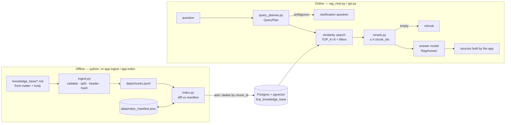
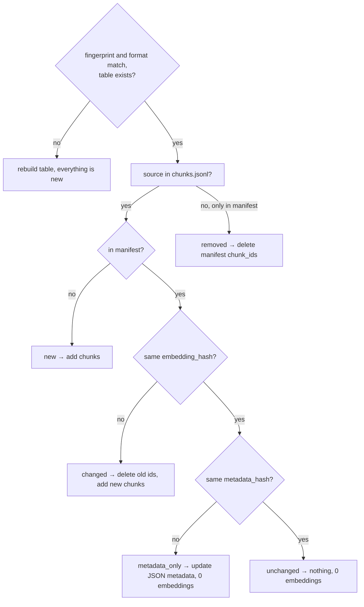
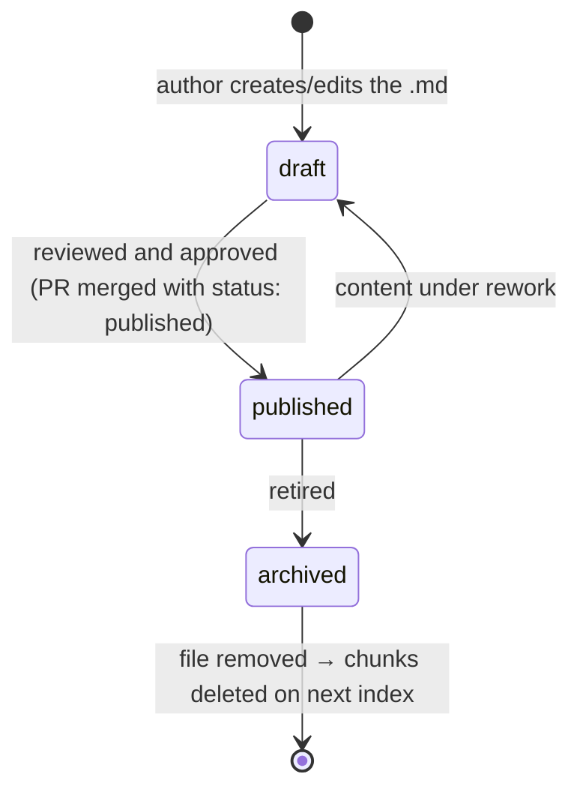

# Design Doc — RAG Knowledge Chat

| | |
| --- | --- |
| **Status** | Describes the current implementation (`main`) |
| **Scope** | Ingestion, indexing, retrieval and answering for the FCAI knowledge base |
| **Related** | [README](../README.md) · [ADRs](adr/README.md) |

## 1. Context and goals

The Knowledge Chat answers questions about the internal documentation of a fictitious
SaaS company (FCAI) using Retrieval-Augmented Generation over Postgres + pgvector.

The design goals that shape every decision below are:

1. **Grounded answers** — the model answers only from retrieved context, and says so
   when the context is not enough.
2. **Verifiable answers** — every answer carries sources the application can prove
   were in the context.
3. **The application owns control, the model owns language** — authorization,
   filtering by status/tenant, ids and sources are decided by code; the model is used
   where judgment about language is needed (planning, reranking, answering).
4. **Cheap and safe to re-run** — ingestion and indexing are deterministic and
   idempotent; nothing is re-embedded unless it changed.
5. **Inspectable** — every step can be observed in isolation (`--debug`,
   `--show-prompt`, `--no-rerank`, `app.retrieve`).

Non-goals: conversation memory, hybrid (BM25) search, streaming answers, a UI, and
multiple live versions of the same document.

## 2. Architecture overview

Two independent flows share the same Postgres table. They never run together: the chat
and the API **only read** the index.



| Module | Responsibility |
| --- | --- |
| `app/ingest.py` | Validate front matter, split Markdown, add context header, hash, write `chunks.jsonl` |
| `app/versioning.py` | `DocumentVersion` (hashes, chunk id), `VersionRegistry` (manifest, diff, rebuild decision), index fingerprint |
| `app/index.py` | Apply the registry's diff (new/changed/metadata-only/removed) to pgvector |
| `app/query_planner.py` | `QueryPlan`, safe filters, filter building, search text, planner↔index contract |
| `app/rerank.py` | `RerankResult`, candidate formatting, id validation |
| `app/rag_pipeline.py` | Orchestration, structured answer, sources, refusal, debug, timings, logs |
| `app/rag_chat.py` / `app/api.py` | Presentation only (terminal / FastAPI) |
| `app/retrieve.py` | Retrieval without any chat model, for inspection |

The chat model is called **exactly three times** per answered question (planner,
reranker, answerer); ingestion and indexing only call the embedding model.

---

## 3. Chunks with metadata

> ADRs: [0001](adr/0001-markdown-aware-chunking-with-document-metadata.md),
> [0002](adr/0002-context-header-in-chunk-text.md)

### Problem

A chunk cut from the middle of a document loses who it belongs to. Without metadata
the system cannot filter (tenant, plan, type, status), cannot cite (file, section,
version), and the embedding cannot tell "P1 response time on **Pro**" from "on
**Enterprise**".

### Structure

**1. Metadata is declared once, per document, in YAML front matter** and is mandatory:

```yaml
---
title: Product Support SLA
tenant: fcai
product: fcai-cloud
plan: all            # starter | pro | enterprise | all
doc_type: sla        # sla | policy | product | plan | company
version: 2026-01
status: published
visibility: internal
---
```

`ingest.load_document()` rejects the file with a clear `IngestionError` if the file is
empty, has no front matter, misses a required field or uses a value outside its allowed `choices` (both declared
in `app/metadata.py`), or has an empty body. A broken document stops ingestion instead of producing unfilterable chunks.

**2. Chunking follows the document structure, then the size limit.**

1. `MarkdownHeaderTextSplitter` splits by `#`, `##`, `###`, keeping the heading path
   (`h1/h2/h3`) in the piece metadata.
2. `RecursiveCharacterTextSplitter(chunk_size=900, chunk_overlap=150)` cuts sections
   that are still too long into overlapping pieces.

The `section` field (`_section()` in `app/metadata.py`) keeps the most specific heading (`h3` → `h2` → `h1`) as `section`.

**3. Every chunk inherits all document metadata and adds its own.** All fields are
declared once in `METADATA_SCHEMA` (`app/metadata.py`) with their scope (`front_matter`,
`document`, `chunk`, `content`, `version`), whether they are required, their allowed values, and
their context-header label; adding a field is one line there:

| Field | Origin | Used for |
| --- | --- | --- |
| `title`, `tenant`, `product`, `plan`, `doc_type`, `version`, `status`, `visibility` | front matter | filters, sources, context header |
| `body_hash`, `embedding_hash`, `metadata_hash` | `DocumentVersion` (section 4) | versioning / change detection |
| `chunk_id` | `{stem}-{embedding_hash[:12]}-{index:04d}` | primary key, citations |
| `source_file` | file name | sources, grouping for the manifest |
| `chunk_index` | position in the document | ordering, id |
| `section` | closest heading | sources, context header |
| `content_length` | length of the final text | diagnostics |

**4. Metadata that matters for meaning is also written into the text.** Metadata is
stored in `langchain_metadata` (JSONB) and is used by filters, but it is **not**
embedded. So `SCHEMA.context_header()` prepends a header to each chunk:

```
Document title: Enterprise Plan
Document type: plan
Product: fcai-cloud
Plan: enterprise
Version: 2026-01
Section: Premium Support

- **24x7** support for critical tickets.
- **Shorter SLA:** P1 with a response within 1 hour ...
```

The header serves two readers: the embedding model (the chunk now "knows" it is about
Enterprise) and the answer model (the final prompt only needs to add the `Chunk ID`).
`python -m app.ingest --no-context-header` turns it off to measure its effect.

**5. Storage.** `index.py` writes into `fcai_knowledge_base` through
`PGEngine` + `PGVectorStore`, with `chunk_id` as a `TEXT` id column. Filters such as
`{"doc_type": {"$in": [...]}}` are translated by `langchain-postgres` into JSONB
predicates that run together with the vector search.

### Trade-offs

- The header costs tokens in every chunk and in every prompt; in exchange retrieval
  stops confusing near-identical sections of different plans.
- `chunk_size=900` / `overlap=150` favors whole list items and table rows over many
  tiny chunks; values are constants in `ingest.py`, easy to experiment with.
- Front matter keys are validated for presence, not for allowed values. The allowed
  values of `doc_type`/`plan` are enforced later, by the planner↔index contract
  (section 7).

---

## 4. Chunks with versioning

> ADRs: [0003](adr/0003-content-addressed-chunk-ids.md) (superseded),
> [0012](adr/0012-version-registry-with-split-hashes-and-index-fingerprint.md)

### Problem

Documents change. The system must know **which version** of a document an answer came
from, must never mix old and new chunks of the same document, must not duplicate rows
when the same content is indexed twice — and should not pay for embeddings when only
metadata changed.

### Structure

All versioning lives in `app/versioning.py`. A document has one editorial version and
three hashes, each with one job; they are computed once per document
(`DocumentVersion.build`) and stamped on every chunk through `Scope.VERSION`:

| Signal | Covers | Owner | A change means |
| --- | --- | --- | --- |
| `version` (e.g. `2026-01`) | human label, must match `YYYY-MM` | author, front matter | shown in the context header, rerank candidates and every `Source` |
| `body_hash` | the Markdown body as written | `DocumentVersion` | the author must bump `version` (`ingest` warns; `--strict-versions` fails) |
| `embedding_hash` | the final chunk texts, header included | `DocumentVersion` | new chunk ids → delete + re-embed |
| `metadata_hash` | the front matter | `DocumentVersion` | update the stored metadata in place, no embeddings |

The embedded content is **baked into the identity of every chunk**:

```
chunk_id = f"{path.stem}-{embedding_hash[:12]}-{index:04d}"
#          product-support-sla-8f3a91c2b4d0-0001
```

Consequences of this id scheme:

- **Deterministic** — same embedded texts, same position → same id. Re-indexing the
  same content is an upsert of identical ids, never a duplicate.
- **Content-addressed** — any change to what is embedded (body, a header field such as
  `version`, chunking parameters) changes every chunk id of that document. Old and new
  chunks can never collide, so a "changed" document is handled as *delete old ids +
  insert new ids* (section 9).
- **Stable across metadata edits** — `status`, `visibility` or `tenant` do not reach the
  embedding, so changing them keeps the ids and only rewrites the stored metadata.
- **Traceable** — from a `chunk_id` in a log or a source you can tell the document and
  the exact embedded version it came from.

`VersionRegistry` (the manifest) stores, per `source_file`, the `version`, the three
hashes, `status` and the list of `chunk_ids` that are live in the index, plus an
**index fingerprint** for the whole table (section 9).

### What is deliberately not supported

- **One live version per document.** When `pro-plan.md` changes, its previous chunks
  are deleted. Historical versions live in git, not in the index. Supporting several
  live versions (e.g. "the 2025 price list") would require `version` as a filter and a
  different id/manifest key.
- **The editorial check is local.** "Body changed ⇒ version bumped" is compared against
  the local manifest; a CI check against the Git base branch is a natural extension.

---

## 5. Answers with sources, refusal and debug

> ADRs: [0004](adr/0004-structured-answer-with-application-built-sources.md),
> [0005](adr/0005-debug-payload-and-content-free-logs.md)

### Problem

A free-text answer cannot be verified: the model may invent a source, cite a file that
was never retrieved, or answer from its prior knowledge. Operators also need to see
*why* an answer happened without leaking prompts or documents into logs.

### Structure

**Structured answer.** The answer model is bound with
`with_structured_output(RagAnswer)`:

```python
class RagAnswer(BaseModel):
    answer: str              # English, based only on the context
    has_answer: bool         # true only if the context supports the answer
    used_chunk_ids: list[str]
```

The final prompt contains only the selected chunks, each as
`[Chunk ID: ...]\nContent:\n...` (the context header already carries title, section,
plan and version). The system prompt forbids prior knowledge and invented sources, and
spells out the exact refusal text.

**Sources are built by the application.** `build_sources()` intersects
`used_chunk_ids` with the documents that were actually in the context
(`select_documents_by_ids()`), and turns each matching document's **own metadata** into
a `Source(source_file, title, section, version)`. Ids the model invented are silently
dropped; duplicates are removed; the model never writes a file name or a version.

**Refusal is a first-class outcome, decided at three gates:**

| Gate | Condition | Model calls avoided |
| --- | --- | --- |
| Retrieval | no chunk passes the filters | reranker + answerer |
| Reranking | reranker selects no chunk (or only invalid ids) | answerer |
| Answer | model returns `has_answer=false` | — |

All three return the same `NO_ANSWER_MESSAGE` with `sources=[]` (the terminal prints
`Sources: No sources.`). When `has_answer=false`, sources are forced to empty even if
the model listed ids.

**Clarification is a separate outcome** (`needs_clarification=true`), produced by the
planner before retrieval (section 6).

**One result type for every caller.** `RagPipelineResult` is a plain Pydantic object
(`answer`, `has_answer`, `needs_clarification`, `sources`, `debug`). The terminal and
the API only render it; neither re-implements pipeline logic.

**Debug payload.** `RagDebug` is always built, and stripped unless the caller asked for
it (`--debug` / `"debug": true`):

| Field | Content |
| --- | --- |
| `request_id` | UUID of the run |
| `query_plan` | the `QueryPlan` + the final `search_query` + the applied `filters` |
| `retrieved_chunks` | rank, score, chunk_id, source, title, section, version, 300-char preview |
| `selected_chunk_ids` | what reached the answer prompt |
| `timings` | `query_planning_ms`, `retrieval_ms`, `reranking_ms`, `answer_generation_ms`, `total_ms` |
| `model_usage` | input/output/total tokens per model (`UsageMetadataCallbackHandler`) |

`--show-prompt` (terminal only) prints the three prompts via an `on_prompt` callback;
the API never exposes prompts.

**Structured logs without content.** Every run emits one JSON line (`rag.pipeline`
logger) with ids, flags, counts, `source_files`, timings and token usage — never
prompts, chunks, answers or credentials. On failure the line carries `error_type` and
`error_message`, and the API returns a generic `500`.

---

## 6. Improving the question

> ADR: [0006](adr/0006-rewrite-the-question-for-retrieval-only.md)

### Problem

What the user types is rarely a good search query: it is short, colloquial, relies on
implicit context ("something serious broke"), may drop literal terms the documents use
("P1", "SCIM", "99.9%"), and is sometimes ambiguous ("the company plan").

### Structure

The planner (section 7) returns three fields dedicated to the question itself:

| Field | Effect |
| --- | --- |
| `normalized_question` | a self-contained, specific rewrite in English — the text that is embedded for the search |
| `exact_terms` | literals worth matching; **appended** to the search text by `build_search_query()` so the rewrite cannot lose them |
| `needs_clarification` + `clarification_question` | stop before retrieval and ask, instead of guessing |

```python
def build_search_query(query_plan):
    return " ".join([query_plan.normalized_question, *query_plan.exact_terms])
```

Example: *"What if something serious breaks on Enterprise?"* → normalized to a P1 /
critical-incident SLA question, `exact_terms=["P1", "Enterprise"]`.

Key rules:

- **The rewrite is for retrieval only.** The reranker sees both the original and the
  normalized question; the answer model answers the **original** question. A rewrite
  that drifted cannot change what the user is answered about, only what is fetched.
- **Clarify only on real ambiguity.** The prompt distinguishes a question that points
  to a specific plan without naming it ("my plan", "the company plan" → clarify) from a
  question that names no plan ("what happens if I exceed the quota?" → one reading,
  `plan=null`, the answer covers every plan). Over-asking is as harmful as guessing.
- **Determinism.** The model runs with `temperature=0`; with the default temperature
  the clarify/guess decision flip-flopped for the same question.

---

## 7. Query planner

> ADRs: [0007](adr/0007-llm-query-planner-with-application-owned-safe-filters.md),
> [0008](adr/0008-generous-doc-type-filter-and-planner-index-contract.md)

### Problem

Vector similarity alone ignores structure the documents already have (type, plan) and
cannot enforce access rules. Filters fix both, but somebody has to choose them per
question — and a wrong filter hides the right answer.

### Structure

**The plan is a typed contract.** One structured-output call returns:

```python
DocType = Literal["sla", "policy", "product", "plan", "company"]
Plan    = Literal["starter", "pro", "enterprise"]

class QueryPlan(BaseModel):
    normalized_question: str
    doc_types: list[DocType] = []     # empty = no type filter
    plan: Plan | None = None          # only when the question is about ONE plan
    exact_terms: list[str] = []
    needs_clarification: bool
    clarification_question: str | None = None
```

`Literal` types mean the planner can never output a type or plan the index does not
use.

**Two kinds of filters, two owners.** `build_filters()` always starts from
application-owned filters and only *adds* content filters from the plan:

```python
SAFE_FILTERS = {"tenant": "fcai", "product": "fcai-cloud", "status": "published"}

filters = dict(SAFE_FILTERS)
if plan.doc_types: filters["doc_type"] = {"$in": plan.doc_types}
if plan.plan:      filters["plan"] = {"$in": [plan.plan, "all"]}
```

| Filter | Owner | Why |
| --- | --- | --- |
| `tenant`, `product`, `status` | application | authorization and publication are not a search decision; a prompt injection must not be able to widen them |
| `doc_type`, `plan` | model (suggestion) | they are about the *meaning* of the question |

`plan` always includes `"all"`, so cross-plan documents (SLA, policies) survive a plan
filter.

**Filters are eliminatory, so the planner is told to be generous.** The metadata filter
works like a `WHERE` before similarity ranking. The prompt therefore asks for *every*
type that could hold the answer (a plan's price is in `policy` **and** `plan`; the
support e-mail in `sla`, `company` **and** `plan`) and for an empty list when unsure.
The prompt's type catalog describes what each type **actually contains**, because that
catalog is the only view of the base the planner has.

**Retrieval is generous too.** `TOP_K=8` (with 5 the right chunk kept missing the cut)
— precision is the reranker's job.

**The planner↔index contract is checked at startup.**
`ensure_planner_covers_index()` reads the distinct `doc_type`/`plan` values from the
table and exits with an actionable message if the index contains a value the planner
cannot produce (otherwise those documents would silently disappear from every filtered
search).

---

## 8. Reranking

> ADR: [0009](adr/0009-llm-reranking-as-precision-step-and-refusal-gate.md)

### Problem

Retrieval is tuned for recall (8 candidates). Sending all of them to the answer model
costs tokens, dilutes attention, and invites citing chunks that are merely similar.

### Structure

- `build_rerank_prompt()` sends the original question, the normalized question, the
  exact terms and each candidate (id, source, title, section, version, content).
- The model returns `RerankResult(selected_chunk_ids: list[str])`, best first, with the
  rules: at most `RERANK_TOP_N=4`, only chunks that directly help, prefer specific over
  generic, prefer chunks with the exact terms, **empty list if nothing supports the
  answer**.
- `select_reranked_documents()` keeps only ids that were really candidates, removes
  duplicates, preserves the model's order and truncates to 4.
- An empty selection short-circuits to the refusal **without calling the answer
  model**.
- `--no-rerank` / `"use_rerank": false` bypasses the step and takes the top 4 by
  similarity, for side-by-side comparison. `reranking_ms` and token usage in the debug
  payload make the cost visible.

The reranker is an LLM (the same chat model, `temperature=0`) rather than a
cross-encoder: no extra dependency or model hosting, and it can reason about exact
terms and plan-specific content. The cost is one extra model call per question.

---

## 9. Manifest, hash and idempotent reindexing

> ADR: [0010](adr/0010-manifest-based-idempotent-incremental-indexing.md)

### Problem

Re-embedding the whole base on every change is slow and costs money; rebuilding the
table blindly creates downtime; inserting without deleting leaves orphan chunks of old
versions that keep being retrieved.

### Structure

**Hashes** — `body_hash`, `embedding_hash` and `metadata_hash` are computed per
document in `ingest.chunk_document()` (section 4) and copied into every chunk.

**Index fingerprint** — `index_fingerprint()` = hash of the embedding model, the table
name and the manifest format. Vectors from different models cannot share a table, so a
different fingerprint (or an older manifest format) means **rebuild**. Chunking
parameters are not part of it: they change the chunk texts, which `embedding_hash`
already catches per document.

**Manifest** — `data/index_manifest.json`, written atomically (temp file + rename) by
`VersionRegistry.write()` after a successful run:

```json
{
  "format": 2,
  "index_fingerprint": "ec49c1d4…",
  "indexed_at": "2026-11-06T14:03:11+00:00",
  "sources": {
    "pro-plan.md": {
      "version": "2026-01",
      "body_hash": "a71c…",
      "embedding_hash": "3b1f…",
      "metadata_hash": "9e02…",
      "title": "Pro Plan",
      "tenant": "fcai",
      "product": "fcai-cloud",
      "status": "published",
      "chunk_ids": ["pro-plan-3b1f…-0000", "pro-plan-3b1f…-0001"]
    }
  }
}
```

**Diff** — `VersionRegistry.diff()` compares each current `DocumentVersion` with the
manifest:



**Apply** — one `store.delete(ids=…)` for removed + changed, one
`store.add_documents(…, ids=chunk_ids)` for new + changed, one batched `UPDATE` of the
`langchain_metadata` column for metadata-only, then the manifest is rewritten from the
current state.

**Idempotency properties**

| Action | Result |
| --- | --- |
| `index` twice in a row | second run: everything `unchanged`, no writes, no embeddings |
| edit one document | only that document's chunks are replaced |
| change only `status`/`visibility` | metadata updated in place, same ids, no embeddings |
| change the embedding model | fingerprint differs → table rebuilt automatically |
| delete a document, `ingest` + `index` | its chunks are deleted from the index |
| no manifest, old manifest format, or table missing | state unknown → table recreated from scratch (`overwrite_existing=True`) |
| `index --force` | delete every id in the manifest, re-add all current chunks |

Deterministic ids are what make this safe: even if a run is interrupted after writing
rows but before saving the manifest, the next run writes the same ids again
(an upsert on `chunk_id`) instead of duplicating them.

**Runtime never indexes.** The chat and the API only read; indexing is an explicit
offline step (`ingest` + `index`).

### Known limits

- The manifest is a local file: it must travel with the database it describes (two
  developers sharing one database with separate manifests will disagree).
- Delete and add are not in a single transaction.

---

## 10. Approval flow

> ADR: [0011](adr/0011-publication-status-as-approval-gate.md)

### Problem

Not every document in the repository is fit to be used as an answer: drafts, documents
under review and retired documents must not reach users, even if they are indexed.

### Structure

The approval flow is modeled as **document state in metadata, enforced by the
application at query time**:



1. **State is mandatory metadata.** `status` (and `visibility`) are required
   in `METADATA_SCHEMA`; ingestion fails if they are missing, so no document enters the
   index with an unknown state.
2. **Approval is an edit to the document.** Changing `status: draft` →
   `status: published` changes the front matter, therefore its `metadata_hash`: the
   next `ingest` + `index` classifies the document as `metadata_only` and updates the
   stored metadata of its chunks in place (same ids, no embeddings — ADR 0012). A
   status-only change is never missed.
3. **Only published content is answerable.** `SAFE_FILTERS` contains
   `status: "published"` and is applied by `build_filters()` on **every** query. It is
   owned by the application: the planner cannot remove or change it, and nothing in the
   user's question can widen it.
4. **Unpublished content is still inspectable.** `python -m app.retrieve --status
   draft "..."` lets a reviewer see how a draft would be retrieved before approving it,
   without exposing it in the chat or API.
5. **Every approved state is auditable.** The manifest records `status` and `version`
   per document, and every answer's sources carry the `version` that was used.

In this repository the review itself happens through the normal Git workflow (a pull
request changing the document and its `status`), and every bundled document is
`published`.

### Known limits

- `status` is validated against `draft`/`published`/`archived` at ingestion, but
  `doc_type` and `plan` have no `choices` yet: their contract is still checked against
  the planner at query time (ADR 0008).
- `visibility` is required and indexed but not yet used as a filter; it is the natural
  place for role-based access (`internal` vs `public`) once callers are authenticated.
- `ensure_planner_covers_index()` checks the whole table, drafts included — a draft
  with a new `doc_type` will already require the planner to be updated.
- There is no reviewer identity or approval timestamp in the metadata; those live in
  the Git history.

---

## 11. Cross-cutting decisions

| Decision | Reason |
| --- | --- |
| Same chat model, `temperature=0`, for planner, reranker and answerer | determinism; one configuration (`OPENAI_CHAT_MODEL`) |
| Structured output everywhere the model makes a decision | the application validates types and ids instead of parsing prose |
| Pipeline shared by terminal and API (`RagPipeline`) | one behavior, two presentations |
| Ingestion/indexing never called at runtime | predictable latency and cost; the index changes only on purpose |
| Isolated utilities (`chat`, `context_chat`, `retrieve`) | baselines to measure each piece's contribution |

## 12. Future work

- Validate `status`, `visibility`, `doc_type` and `plan` values at ingestion.
- Use `visibility` as an application-owned filter tied to the caller's identity.
- CI check "body changed ⇒ `version` bumped" against the Git base branch (today it is
  checked against the local manifest).
- Hybrid retrieval (BM25 + vectors) to complement `exact_terms`.
- Multiple live versions per document (`version` as a filter) if historical answers
  are ever required.
